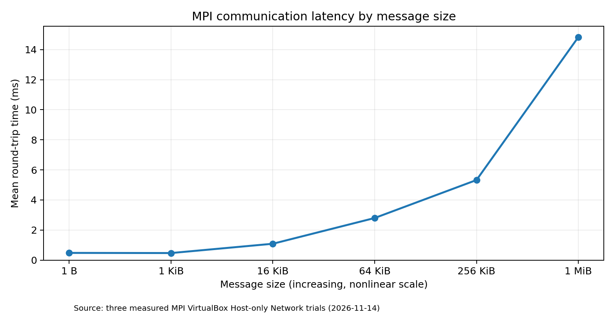
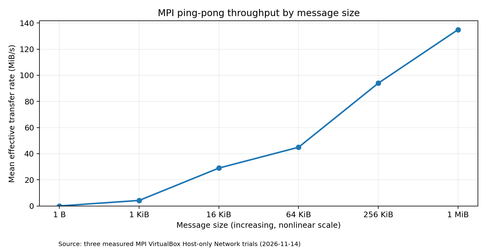

# Parallel Programming and Data Exchange Between Two Networked Computer Systems Using MPI

**An end-to-end two-node MPI project with C source code, setup instructions, distributed execution, functional tests, and measured communication performance.**

> **Assignment:** “Consider two computer systems, System 1 and System 2, connected through a network. Each system has a CPU. Your task is to develop parallel programs using the Message Passing Interface (MPI) to exchange data between the two systems.”

This repository implements **four working Message Passing Interface (MPI) programs** on **two Ubuntu Server 24.04.5 LTS virtual machines**. The VMs communicate through a VirtualBox **Host-only Network**, with Open MPI launching one process on each node using SSH. The actual experiments were performed on two **virtual systems hosted by one Intel iMac**, **not two separate physical computers**.

## Quick links

- [Source code](src/)
- [Captured experimental results](results/reference/)
- [Proof screenshots](docs/screenshots/)
- [Performance graphs](docs/graphs/)
- [Full PDF project report](docs/MPI_Project_Report.pdf)
- [Test cases and expected outputs](docs/TEST_PLAN.md)
- [How to publish this prepared folder to GitHub](PUBLISH_TO_GITHUB.md)

## 1. Project outcomes

| Experiment | File | MPI primitives | Verified outcome |
|---|---|---|---|
| 1. Two-way data exchange | `src/data_exchange.c` | `MPI_Send`, `MPI_Recv` | Node 1 sends 42; Node 2 returns 43 |
| 2. Parallel array summation | `src/parallel_sum.c` | `MPI_Scatter`, `MPI_Reduce` | Local sums 10 and 26; global sum **36** |
| 3. Collective communication | `src/collective_comm.c` | `MPI_Bcast`, `MPI_Gather` | Rank 0 gathers **[50, 100]** |
| 4. Latency/throughput benchmark | `src/mpi_performance.c` | `MPI_Wtime`, `MPI_Send`, `MPI_Recv`, `MPI_Barrier` | Six message sizes, 1 B–1 MiB; three additional trials |

Extra validation includes **bidirectional ping**, **one-process negative testing**, **MPI rank-to-node mapping**, and **three-run performance repeatability**. The reference logs and screenshots are from the completed experiment, not invented samples.

## 2. Tested architecture

```text
                        Intel iMac (macOS host)
                                  |
                        Oracle VirtualBox
                    +-------------+-------------+
                    |                           |
          +---------v---------+       +---------v---------+
          | System 1          |       | System 2          |
          | VM: MPI-Node1     |       | VM: MPI-Node2     |
          | Ubuntu 24.04.5    |       | Ubuntu 24.04.5    |
          | Open MPI 4.1.6    |       | Open MPI 4.1.6    |
          | Rank 0            |       | Rank 1            |
          | 192.168.56.201    |       | 192.168.56.202    |
          +---------+---------+       +---------+---------+
                    |                           |
                    +--- HostNetwork (Host-only)+
                           192.168.56.0/24
                     MPI messages + SSH (TCP/IP)

      Each VM separately has Adapter 1: NAT for internet/apt.
      Adapter 2: Host-only Network for inter-VM communication.
```

| Requirement | Tested configuration |
|---|---|
| Host | Intel x86_64 iMac, macOS 15.8.2; 8 GiB RAM |
| Hypervisor | Oracle VirtualBox |
| Guests | Two Ubuntu Server 24.04.5 LTS x86_64 VMs |
| Guest login | `vboxuser` on each node |
| MPI | Open MPI 4.1.6 (on both nodes) |
| C toolchain | GCC 13.3.0 / `mpicc` (on both nodes) |
| System 1 | `MPI-Node1`, `192.168.56.201/24`, host-only `enp0s8` |
| System 2 | `mpi-node2`, `192.168.56.202/24`, host-only `enp0s8` |
| Networking | Adapter 1 NAT + Adapter 2 VirtualBox Host-only `HostNetwork` |
| File transfer | SSH / SCP, with executable copied to both VMs |

**Limitation:** Both virtual machines share one physical host's hardware. This is a **two-node virtual distributed environment** and demonstrates inter-VM MPI communication; it does not measure performance over two physical networked computers.

## 3. Repository structure

```text
mpi-two-node-parallel-computing/
├── README.md
├── Makefile
├── .gitignore
├── .github/workflows/build-and-local-tests.yml
├── src/
│   ├── data_exchange.c
│   ├── parallel_sum.c
│   ├── collective_comm.c
│   └── mpi_performance.c
├── config/
│   ├── 99-mpi-node1.yaml
│   └── 99-mpi-node2.yaml
├── scripts/
│   ├── common.sh
│   ├── deploy.sh
│   ├── run_mpi.sh
│   └── repeatability.sh
├── tests/
│   └── smoke_test.sh
├── analysis/
│   └── analyze_performance.py
├── results/
│   ├── reference/
│   │   ├── performance_repeatability.txt
│   │   ├── performance_summary.csv
│   │   └── process_mapping.txt
│   └── local/                 # ignored; generated by your own runs
└── docs/
    ├── MPI_Project_Report.pdf
    ├── TEST_PLAN.md
    ├── graphs/
    └── screenshots/
```

The four C source files and raw reference results are preserved from the submitted source archive. `bin/` is deliberately excluded from Git: **build the executables locally** for your own Ubuntu/Open MPI environment.

## 4. From scratch: set up two Ubuntu virtual machines

Follow **Steps 4.1–4.7** if you're recreating the system. If both Ubuntu nodes already exist with the IP addresses and SSH configured, go to **Section 5**.

### 4.1 Install VirtualBox and create Ubuntu VMs

1. Install Oracle VirtualBox on your host. The tested system used an Intel x86_64 Mac; choose a compatible hypervisor and guest architecture on other hosts.
2. Download an **Ubuntu Server 24.04 LTS x86_64** installation ISO.
3. Create `MPI-Node1`: Linux → Ubuntu (64-bit), a virtual disk of about 25 GiB, and about 2 GiB RAM (the tested machine had 8 GiB total host RAM). Install Ubuntu and create a regular user named `vboxuser`.
4. Shut down the installed VM and **Full Clone** it as `MPI-Node2`, with **new MAC addresses**; alternatively, install the second VM independently. A full clone inherits user credentials and system settings, so give the two systems unique identities.
5. On Node 2, set its hostname with `sudo hostnamectl set-hostname mpi-node2`. On Node 1, use `sudo hostnamectl set-hostname MPI-Node1` if not already set. Update the `127.0.1.1` entry in each VM's `/etc/hosts` to match its own hostname. If cloning, also ensure each guest has a unique `/etc/machine-id` before using them as distinct nodes.
6. Shut down both VMs before changing their virtual network adapters.

For the verified implementation, both virtual machines had OpenSSH and MPI installed afterward; no GUI desktop was required inside Ubuntu.

### 4.2 Set up the VirtualBox private network

1. In **VirtualBox Manager → File → Tools → Network Manager → Host-only Networks**, create a Host-only Network named `HostNetwork` (on some VirtualBox versions the UI calls it a Host-only Adapter).
2. Use subnet **`192.168.56.0/24`**, subnet mask **`255.255.255.0`**. Our tested host-only network displayed an allocation range `192.168.56.1`–`192.168.56.199`; we deliberately assigned static VM addresses `.201` and `.202` outside that range. If your host-only network's allocation differs, adjust the addresses to nonconflicting IPs on the same subnet.
3. On **each powered-off VM → Settings → Network**:
   - **Adapter 1:** enabled, **NAT** (keep it for package downloads).
   - **Adapter 2:** enabled, **Host-only Network**, **Name: `HostNetwork`**, virtual cable connected.
4. Start both VMs. Check that the second interface exists using `ip -br link`. In the tested Ubuntu setup it is `enp0s8`; on another VM the name may differ.

### 4.3 Configure permanent VM IP addresses

We use Ubuntu **Netplan** and **leave the existing NAT interface configuration untouched**.

On **MPI-Node1**:

```bash
sudo cp config/99-mpi-node1.yaml /etc/netplan/99-mpi-hostonly.yaml
sudo chmod 600 /etc/netplan/99-mpi-hostonly.yaml
sudo netplan generate
sudo netplan apply
ip -br -4 addr show enp0s8
# Expected: enp0s8 UP 192.168.56.201/24
```

On **MPI-Node2**, use the second YAML file:

```bash
sudo cp config/99-mpi-node2.yaml /etc/netplan/99-mpi-hostonly.yaml
sudo chmod 600 /etc/netplan/99-mpi-hostonly.yaml
sudo netplan generate
sudo netplan apply
ip -br -4 addr show enp0s8
# Expected: enp0s8 UP 192.168.56.202/24
```

**Important:** The paths above assume you have copied or cloned this repository onto each guest already. If you're configuring networking **before obtaining the repository**, create `/etc/netplan/99-mpi-hostonly.yaml` manually with the contents of [`config/99-mpi-node1.yaml`](config/99-mpi-node1.yaml) or [`config/99-mpi-node2.yaml`](config/99-mpi-node2.yaml), respectively. Both files configure only `enp0s8`; do not overwrite Ubuntu's `50-cloud-init.yaml` containing your NAT DHCP settings.

Avoid applying network settings during other critical work, as interfaces can briefly disconnect. Reboot each VM and repeat `ip -br -4 addr show enp0s8` to verify the addresses are persistent.

### 4.4 Verify bidirectional connectivity

From **MPI-Node1**:

```bash
ping -c 4 192.168.56.202
```

From **MPI-Node2**:

```bash
ping -c 4 192.168.56.201
```

**Pass criterion:** each node receives 4 replies and shows `0% packet loss`. The completed project met this criterion in both directions.

### 4.5 Install SSH and MPI dependencies on BOTH guests

Run on **each Ubuntu VM** (first Node 1, then Node 2):

```bash
sudo apt update
sudo apt install -y openssh-server openmpi-bin libopenmpi-dev build-essential python3
sudo systemctl enable --now ssh
mpicc --version
mpirun --version
```

Expected on the tested installation: GCC **13.3.0** (`mpicc --version` reports the underlying GCC) and `mpirun (Open MPI) 4.1.6`. Compatible Open MPI versions can work, but using the same version on both nodes is recommended. Don't use macOS's MPI compiler inside Linux.

### 4.6 Configure Node 1 → Node 2 passwordless SSH

On **MPI-Node1** as `vboxuser`:

```bash
ssh-keygen -t ed25519
# Choose default path, and use a passphrase or an appropriate SSH agent setup.
ssh-copy-id -i ~/.ssh/id_ed25519.pub vboxuser@192.168.56.202
ssh -o BatchMode=yes vboxuser@192.168.56.202 hostname
# Expected: mpi-node2
```

For unattended lab scripts, an SSH agent with an unlocked key (or an appropriately protected, unencrypted key in this isolated lab) can avoid interactive prompts. **Do not commit private keys** into Git, and verify the remote host fingerprint when SSH first asks.

The reference implementation launched distributed programs **from Node 1**, so Node 1 → Node 2 authentication is sufficient for the documented commands. Launching jobs from Node 2 would also require appropriate reverse-direction SSH authentication.

### 4.7 Optional terminal access from macOS

Because the host-only network is reachable from the macOS host in the tested setup, you can open your ordinary Mac Terminal and run:

```bash
ssh vboxuser@192.168.56.201    # MPI-Node1
ssh vboxuser@192.168.56.202    # MPI-Node2
```

This makes command copy/paste much easier than typing inside the VirtualBox text console.

## 5. Download / clone the repository on Node 1

Create a **public or private** GitHub repository containing these files first (the packaged ZIP can be uploaded through the GitHub website or pushed using Git). Then, on **MPI-Node1**, run:

```bash
# Replace YOUR_USERNAME with the actual GitHub account name:
git clone https://github.com/YOUR_USERNAME/mpi-two-node-parallel-computing.git ~/mpi-two-node-parallel-computing
cd ~/mpi-two-node-parallel-computing
```

For the **already existing project environment** (`~/mpi-project` from the original work), this clones to a **new separate folder** and leaves your original files intact. Alternatively, transfer the unpacked repository to Node 1 using `scp` from the Mac. Keep the same **absolute repository path** on both nodes for remote executable launch.

> If using the downloadable ZIP rather than GitHub, unzip it and copy the extracted folder to `/home/vboxuser/mpi-two-node-parallel-computing` on MPI-Node1.

## 6. Build the complete project on MPI-Node1

```bash
cd ~/mpi-two-node-parallel-computing
make
ls -lh bin/
```

This compiles the **four unmodified C programs** via `mpicc -Wall -Wextra -O2`:

```text
bin/data_exchange
bin/parallel_sum
bin/collective_comm
bin/mpi_performance
```

If you prefer manual compilation, use these equivalent commands:

```bash
mkdir -p bin
mpicc -Wall -Wextra -O2 -o bin/data_exchange src/data_exchange.c
mpicc -Wall -Wextra -O2 -o bin/parallel_sum src/parallel_sum.c
mpicc -Wall -Wextra -O2 -o bin/collective_comm src/collective_comm.c
mpicc -Wall -Wextra -O2 -o bin/mpi_performance src/mpi_performance.c
```

## 7. Deploy executables to MPI-Node2

From **MPI-Node1**, inside the repository:

```bash
make deploy
```

This script creates the same directory on MPI-Node2 and securely transfers the four compiled binaries. Its SSH login uses `BatchMode=yes`, which means key-based authentication must be configured first. To verify manually:

```bash
ssh vboxuser@192.168.56.202 'ls -l ~/mpi-two-node-parallel-computing/bin/'
```

Both nodes must have `bin/<program>` accessible under **the same absolute path**. The scripts default to `vboxuser`, `192.168.56.201`, `192.168.56.202` and `192.168.56.0/24`. You can override the network parameters via environment variables `MPI_USER`, `NODE1_IP`, `NODE2_IP`, and `MPI_SUBNET` (but change the Netplan addresses accordingly).

## 8. Run all four experiments (on MPI-Node1)

### 8.1 Simple commands using the supplied scripts

```bash
cd ~/mpi-two-node-parallel-computing
bash scripts/run_mpi.sh data_exchange
bash scripts/run_mpi.sh parallel_sum
bash scripts/run_mpi.sh collective_comm
bash scripts/run_mpi.sh mpi_performance
```

The script starts **exactly two MPI processes**, one assigned to each VM, over our private network. Each line is tagged by its producing MPI rank.

### 8.2 Equivalent manual Open MPI command

```bash
mpirun -np 2 \
  --host 192.168.56.201:1,192.168.56.202:1 \
  --mca btl_tcp_if_include 192.168.56.0/24 \
  --tag-output \
  "$PWD/bin/data_exchange"
```

Replace `data_exchange` with the other executable names to run different experiments. **Run MPI from Node 1, not from the Mac shell**; the Mac is the host for the VMs.

### 8.3 Expected functional outputs

**Experiment 1 — point-to-point message exchange**:

```text
System 1: Sending 42 to System 2
System 2: Received 42 from System 1
System 1: Received 43 from System 2
```

**Experiment 2 — distributed parallel sum**:

```text
Rank 0 on MPI-Node1: Local sum = 10
Rank 1 on mpi-node2: Local sum = 26
Final parallel sum = 36
```

**Experiment 3 — broadcast / gather**:

```text
Rank 0: Broadcasting multiplier = 5
Rank 0 on MPI-Node1: 10 x 5 = 50
Rank 1 on mpi-node2: 20 x 5 = 100
Final gathered results: [50, 100]
```

**Experiment 4 — performance**: a six-row table with message sizes `1`, `1024`, `16384`, `65536`, `262144`, and `1048576` bytes, along with RTT, approximate one-way latency, and effective throughput.

MPI prints from separate processes are buffered and collected independently, so **the terminal line order can vary** even when the computation is correct.

## 9. Run tests and save new logs

### 9.1 Automated functional + negative tests

```bash
make test
```

`tests/smoke_test.sh` executes the **four real two-VM MPI programs** and checks their expected output. It also runs `data_exchange` with **one process** and confirms that the program rejects the invalid configuration with a nonzero exit status. Reports are written to `results/local/` and are intentionally ignored by Git.

### 9.2 Verify process placement on both VMs

```bash
make mapping
```

The `--display-map` report should associate **rank 0** with `MPI-Node1` and **rank 1** with `192.168.56.202` / `mpi-node2`, one slot/process per system. Current output is saved to `results/local/process_mapping_latest.txt`; see the archived successful [`process_mapping.txt`](results/reference/process_mapping.txt).

### 9.3 Measure latency and throughput again

```bash
make performance
make repeatability
```

`make performance` performs a fresh single benchmark. `make repeatability` runs the benchmark **three times**, writing the log to `results/local/performance_repeatability_latest.txt`. Measurements will change with system load; do not expect to reproduce the exact reference timing numbers.

### 9.4 Summarize the performance data

```bash
make summary
# Or summarize your NEW three-run log:
python3 analysis/analyze_performance.py \
  results/local/performance_repeatability_latest.txt \
  --csv results/local/performance_summary_latest.csv
```

The analysis script uses **only Python's standard library**. The supplied figure images under `docs/graphs/` were produced from the archived three-trial reference file.

### 9.5 Manual invalid-process-count test

```bash
mpirun -np 1 ./bin/data_exchange
```

Expected message: `This program requires exactly 2 MPI processes.` The Open MPI process exits with status **1**; for this **negative test**, a nonzero exit status means the application correctly rejected invalid input.

## 10. Actual recorded performance results

The final recorded **three trial average** from `results/reference/performance_repeatability.txt` is:

| Message size | Mean RTT (ms) | Mean approximate one-way (ms) | Mean effective throughput (MiB/s) |
|---|---:|---:|---:|
| 1 B | 0.4783 | 0.2391 | 0.0040 |
| 1 KiB | 0.4687 | 0.2343 | 4.21 |
| 16 KiB | 1.0873 | 0.5436 | 28.98 |
| 64 KiB | 2.7996 | 1.3998 | 44.92 |
| 256 KiB | 5.3245 | 2.6622 | 93.96 |
| 1 MiB | 14.8304 | 7.4152 | 134.94 |

**Method:** After 10 warm-up exchanges for each message size, rank 0 times 1,000 ping-pong exchanges for `1 B` and `1 KiB`, or 100 exchanges for larger sizes. Each exchange sends a message to rank 1 and receives the returned message. Measurements use `MPI_Wtime()`. Mean RTT is total elapsed time / iterations; approximate one-way latency is **RTT/2** (not independently measured); effective throughput counts **both directions**: `2 × message_size × iterations / elapsed_seconds`, converted to MiB/s. For 1-byte messages, the original C program prints a rounded `0.00` rate; the higher-precision summary recomputes it from RTT.





**Interpretation:** Time generally increases with message size, while measured effective throughput improves for larger transfers. The results are specific to the tested VirtualBox host-only network and shared-host VM scheduling. They are **not** a measurement of physical Ethernet bandwidth, nor proof that distributed execution is faster than a single machine for these tiny calculations.

## 11. Evidence screenshots

Screenshots are captured from the **actual completed setup**. The [`docs/screenshots/`](docs/screenshots/) folder contains the bidirectional network tests, MPI versions, four experiments, negative test, three performance runs, and two-node process mapping.

| Evidence | Image |
|---|---|
| First two-way MPI message exchange | [View](docs/screenshots/experiment1-data-exchange.png) |
| Parallel array sum | [View](docs/screenshots/experiment2-parallel-sum.png) |
| Broadcast and gather | [View](docs/screenshots/experiment3-collective.png) |
| Communication benchmark | [View](docs/screenshots/experiment4-performance.png) |
| Invalid number of processes | [View](docs/screenshots/negative-test.png) |
| Three performance repeats | [View](docs/screenshots/repeatability.png) |
| One MPI rank per VM | [View](docs/screenshots/process-map.png) |

## 12. Troubleshooting

| Symptom | Likely cause / remedy |
|---|---|
| `ip -br -4 addr show enp0s8` has no address | Adapter 2 not enabled, interface DOWN, or Netplan missing. Check `ip -br link`, VirtualBox Adapter 2, `sudo netplan generate` and `sudo netplan apply`. |
| Both machines display NAT `10.0.2.15` | Normal with separate default NAT adapters. Use their **host-only** addresses `.201` / `.202` for MPI. |
| `ping` has packet loss | Confirm both VMs are running and attached to the **same** HostNetwork, that `enp0s8` is UP and IPs are unique. |
| SSH: `Connection refused` | Install/enable SSH server on the target guest: `sudo apt install openssh-server && sudo systemctl enable --now ssh`. |
| SSH prompts for a password | Check `ssh-copy-id`, authorized keys, and test `ssh -o BatchMode=yes vboxuser@192.168.56.202 hostname` from Node 1. |
| `mpicc` or `mpirun` not found | On **both VMs**, install `openmpi-bin libopenmpi-dev build-essential`. |
| MPI cannot find executable on remote VM | Run `make deploy`; use the same absolute project location on both nodes; confirm the binary exists and is executable. |
| MPI job hangs | Verify SSH keys, network/host-only link, and that **both processes** enter matching MPI collectives in the same order. |
| `netplan generate` reports indentation error | YAML uses spaces, not tabs; use the supplied node-specific YAML examples and ensure correct indentation. |
| Output lines out of order | Expected for independently buffered MPI processes. Judge correctness by the values and ranks, not line ordering. |
| `0.00 MiB/s` for a 1-byte message | Two-decimal display rounding, not truly zero throughput. Use the higher-precision CSV. |

## 13. GitHub Actions note

`.github/workflows/build-and-local-tests.yml` compiles all four programs and tests **two MPI processes on one Ubuntu GitHub Actions runner**. This is a useful fast regression check, but it **does not replace the actual two-VM distributed tests** documented in this README and the included screenshots/logs.

## 14. References

- [MPI Forum — MPI Standard](https://www.mpi-forum.org/docs/)
- [Open MPI documentation](https://docs.open-mpi.org/)
- [Ubuntu Server documentation](https://ubuntu.com/server/docs)
- [Netplan documentation](https://netplan.readthedocs.io/)
- [Oracle VirtualBox manual](https://www.virtualbox.org/manual/)

---

**Submission contents:** Four original C source files; a detailed self-contained README; Makefile and helper scripts; test automation; recorded experiment output and performance summary; screenshots; plots; and the full PDF report. The code was demonstrated on two networked Ubuntu VMs in VirtualBox, one process per VM.
